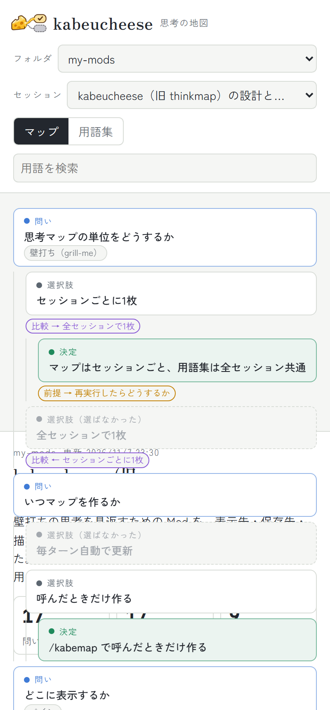

# kabeucheese

Claude Code で Claude と壁打ちしたときに、自分がどんな思考をたどったかを後から見返すための Mod（プラグイン）。

名前は「壁打ち（kabeuchi）」と「チーズ（cheese）」から。壁打ちーズ、あるいは壁打チーズ。チーズが糸を引いて伸びるように、考えと考えが線でつながって伸びていく様子を表している。

会話の中の「問い → 選択肢 → 決定」を流れ図にして、途中で「○○について教えて」と聞いた言葉は用語カードにまとめる。保存先は自分専用の Artifact（claude.ai のページ）なので、複数のPCやスマホのどれから開いても同じマップが見える。


> スクリーンショットは、kabeucheese 自体を設計したときの壁打ちを例にしている。

## できること

- **論点の地図**：問い → 選択肢 → 決定を左から右への流れ図で描く。選ばなかった案も灰色で残す。論点どうしの関係（比較・理由・前提・変更）は点線の曲線で結ぶ
- **差分で育つ**：同じセッションでもう一度 `/kabemap` すると、前回のマップに新しい論点を足す。覆った決定は「変更前の決定」として取り消し線で残り、新しい決定と「変更」の線で結ばれる
- **前のセッションの続き**：新しいセッションで `/kabemap` すると、同じフォルダで直近に更新したセッションを「前回」として、最初の問いと前回の論点を「続き」の線で結ぶ。前回のマップの決定を覆したときは、前回のマップでもその決定が「変更前」になり、新しい決定へ「変更」の線でつながる。セッションをまたぐ線は、押すと相手のマップへ飛ぶチップとして表示する（フォルダを選ばずに始めた「未分類」のセッションは結ばない）
- **拡大・縮小**：マップの右下のボタン、Ctrl（Mac は ⌘）＋ホイールやトラックパッドのピンチ、`+` `-` キーで拡大・縮小できる。拡大は 200% まで。縮小はマップ全体がウィンドウに収まる倍率で止まり、もともと収まる小さなマップは 100% より小さくならない。「全体」（`0` キー）で全体が見える倍率にする
- **用語カード**：聞いた言葉の定義・自分の文脈での意味・出てきた場所を保存する。用語集は全セッション共通で積み上がる
- **フォルダで分ける**：セッションごとに作業フォルダ名（`jobHunting`、`research` など）が付く。別フォルダの論点への参照線も引ける
- **メモ**：論点や用語に自分のメモを書ける。再解析しても消えない

## 必要なもの

- Claude Code（デスクトップアプリ、または `claude` コマンド）
- Artifact とそのデータベース機能が使える claude.ai のアカウント

## 導入

1. マーケットプレイスとして登録して入れる。

   ```bash
   claude plugin marketplace add sota28hizumi/kabemap
   claude plugin install kabeucheese@kabeucheese
   ```

   手元に clone して使う場合は、`marketplace add` に clone したフォルダのパスを渡す。

2. 新しいチャットを開き、`/kabemap` と `/kabeview` が候補に出れば入っている。

## はじめての設定（保存先の Artifact を作る）

マップの本体は、自分の claude.ai に置く Artifact。最初に一度だけ作る。

1. Claude Code のチャットで、次のように頼む（パスは kabeucheese を置いた場所に合わせる）。

   > kabeucheese の `artifact/index.html` を、`capabilities` に `{"db": {}}` を付けて Artifact として公開して

   プラグインとして入れた場合、`artifact/index.html` は `~/.claude/plugins/` の下にもある。この README のリポジトリから取ってもよい。

2. 公開された URL（`https://claude.ai/artifact/...`）を、保存先として設定する。

   ```
   /kabemap https://claude.ai/artifact/xxxxxxxx
   ```

   URL はそのPCに保存される。別のPCでも同じ URL を設定すれば、同じマップを共有できる。

   自分で clone して使う場合は、`config.json` の `artifactUrl` に書いてもよい（こちらが優先される）。

## 使い方

| コマンド | すること |
|---|---|
| `/kabemap` | 今のセッションの会話を Claude が見直し、マップと用語をデータベースに保存して、概要のペインを開く |
| `/kabemap <URL>` | 保存先の Artifact を設定する（初回だけ） |
| `/kabeview` | 解析せずに、保存済みの概要でペインを開き直す（ペインを閉じたとき用。トークンをほぼ使わない） |

壁打ちのキリのいいところで `/kabemap` を送り、ペインのリンクから本体のページを開く。

## 画面

### 論点の詳細と、覆った決定

論点を押すと、右のパネルに中身・付いている用語・つながり・メモ欄が出る。下の例では、データベースの分け方の旧案（取り消し線）が新しい案に「変更」の線で結ばれている。


### 用語カード

論点に付いた用語を押すと用語カードが開く。最初は「ひとこと定義・自分の文脈での意味・出てきた場所」だけで、「詳しく」を押すと詳しい説明・具体例・関連用語・出典・メモ欄が開く。出てきた場所を押すと、そのセッションのその論点へ飛ぶ。

出典は「Webで裏付けあり（URL つき）」と「Claudeの説明（出典なし）」で分けて表示する。


### 用語集

「用語集」タブで、選んでいるフォルダ（または全フォルダ）の用語を一覧できる。上の検索欄からも探せる。


### スマホ・ダークモード

スマホ幅では縦のツリーに切り替わる。ダークモードにも対応している。

<p>
  
  
</p>

### ペイン

`/kabemap` のあと、チャットの横のペインに次を出す。

- このセッションの問いと決定の一覧（覆った決定は取り消し線）
- 件数（問い・決定・新しい用語）のタイル
- 新しく登録した用語の名前
- 本体のページを開くリンク

## 仕組み

```
/kabemap ──▶ Claude が kabeucheese:analyze スキルの手順で会話を見直す
                │  mcp__kabeucheese__context でセッションIDとフォルダ名を受け取る
                ▼
             Artifact のデータベースに差分で書き込む（ArtifactData）
                │
                ▼
             mcp__kabeucheese__show で概要を渡し、ペインを開く
```

| 場所 | 役割 |
|---|---|
| `hooks/register.tsx` | `/kabemap`・`/kabeview`、ペイン、Claude が呼ぶツール `mcp__kabeucheese__context`（セッションIDとフォルダ名を返す）と `mcp__kabeucheese__show`（ペイン用の概要を受け取る） |
| `skills/analyze/SKILL.md` | 解析の手順とデータベースへの書き込み形式 |
| `artifact/index.html` | Artifact 本体のソース |
| `config.json` | 保存先の Artifact の URL（空なら `/kabemap <URL>` で設定したものを使う） |
| `docs/` | この README のスクリーンショット |

データベース（Artifact の `db`）：

- `sessions/<セッションID>`：`folder`・`title`・`summary`・`nodes`（論点）・`edges`（枝をまたぐ線。別セッションへの線は `toSession` 付き）・`previousSessionId`（続きとして結んだ前回のセッション）
- `terms/<用語ID>`：定義・文脈での意味・詳しい説明・具体例・関連用語・出典・`occurrences`（出てきたフォルダ／セッション／論点）
- `memos/<キー>`：ページで書いたメモ。ページだけが書き、Claude の再解析では触らない
- `meta/current`：最後に `/kabemap` したセッション（ページを開いたときの初期表示に使う）

フォルダ名は作業フォルダの末尾の名前。フォルダを選ばずに始めたセッション（ホームや一時フォルダ）は「未分類」になる。

## プライバシー

- 本体の Artifact は作った人専用で、共有しない限り他の人は開けない
- 会話の原文は保存しない。要約した論点・決定・用語だけを書く
- 学籍番号・住所・電話番号など、個人を特定できる情報は書かないようスキルで指示している

## テスト

```bash
claude plugin test .
```

## ライセンス

MIT
